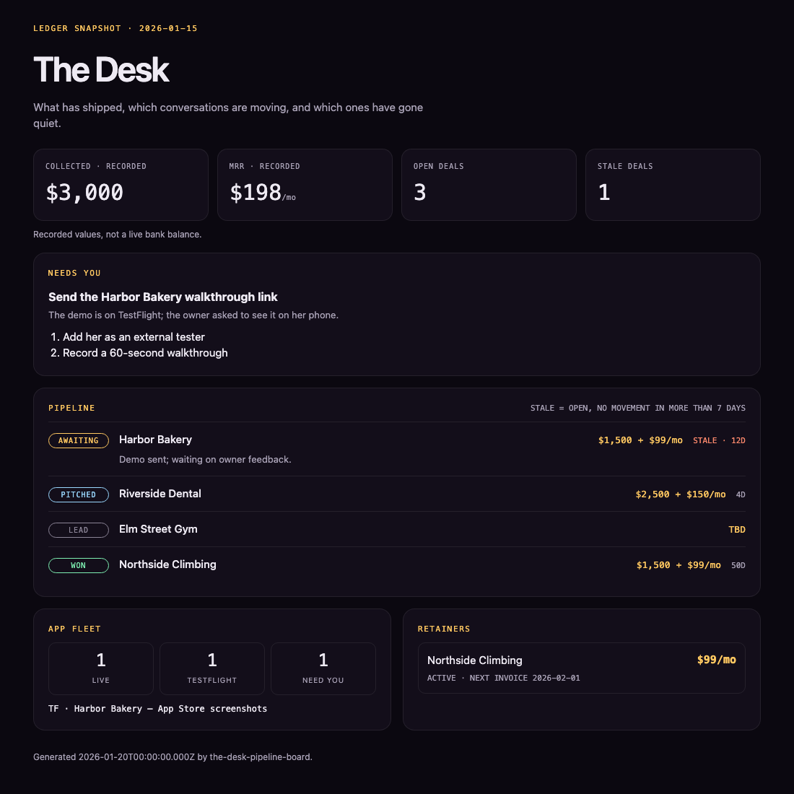
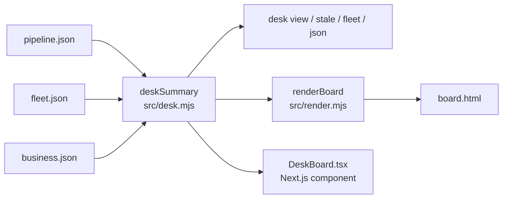

# The Desk

A read-only operating board for a small studio. It reads three JSON files you edit by hand (deal pipeline, app fleet, recorded ledger) and shows which deals are waiting on a reply, which have gone quiet, what is live or on TestFlight, and what only you can do next. You can view it in the terminal or as a static HTML page.



It started as "The Desk" tab in the Business room of Omega, Ian's local dashboard, and is published here as a standalone tool.

## Why

A one-person studio doesn't need a CRM. It needs one honest page: the money actually recorded, the deals in motion, and the ones nobody has touched in over a week. Keeping the data in plain JSON means you can edit it in any editor, keep it in a private folder, and let scripts or agents read it without an API.

## Features

- **Pipeline board**: deals sorted with `awaiting` first, then `pitched`, `lead`, `won`, `lost`. Unknown stages sort last instead of breaking the board.
- **Stale-deal flags**: an open deal with no movement in more than 7 days (configurable with `--stale-days`) is marked stale. Won and lost deals never are.
- **`desk stale` for alerts**: prints the stale deals and exits 1 when there are any, so a cron job or CI step can notify you.
- **Fleet counts**: live, TestFlight and "needs you" apps, with the TestFlight blockers listed.
- **Recorded ledger**: collected revenue and MRR with their as-of date, labeled as recorded values, not a live balance.
- **Static HTML board**: `desk html` writes one self-contained page (no scripts, no external assets) with light and dark themes and a phone-width layout. Every value from the JSON is HTML-escaped.
- **Zero dependencies**: Node's standard library only.

## How it works



`deskSummary()` is a pure function: it takes the parsed files and a timestamp and returns sorted deals with their ages, stale names, open-deal count, fleet summary, retainers and "needs you" items. The CLI, the HTML renderer and the React component all use it.

## Data format

See `data/example/` (all fictional).

```jsonc
// pipeline.json
{ "deals": [ { "name": "Harbor Bakery", "stage": "awaiting", "value": "$1,500 + $99/mo", "note": "Demo sent", "moved": "2026-01-08" } ] }
// fleet.json
[ { "name": "Harbor Bakery", "status": "testflight", "needs": "App Store screenshots", "tagline": "…" } ]
// business.json
{ "ledger": { "asOf": "2026-01-15", "collected": 3000, "mrr": 198 },
  "retainers": [ { "client": "Northside Climbing", "amount": 99, "status": "active", "nextInvoice": "2026-02-01" } ],
  "needsYou": [ { "title": "…", "why": "…", "steps": ["…"] } ] }
```

`stage` is one of `lead`, `pitched`, `awaiting`, `won`, `lost`. `moved` is the date the deal last changed.

## Getting started

```bash
git clone https://github.com/ianroyes-sys/the-desk-pipeline-board.git
cd the-desk-pipeline-board
npm test                                        # 8 tests

node bin/desk.mjs view --now 2026-01-20         # terminal board over data/example
node bin/desk.mjs stale --now 2026-01-20        # stale deals; exit 1 if any
node bin/desk.mjs fleet
node bin/desk.mjs html --out board.html && open board.html
```

To use your own data, put `pipeline.json`, `fleet.json` and `business.json` in `data/` (ignored by git) or pass `--data /path/to/folder`. Leave out `--now` to use today's date.

### React component

`omega-ui/components/DeskBoard.tsx` renders the same summary inside a Next.js or React app: `<DeskBoard pipeline={...} fleet={...} business={...} />`. It imports `src/desk.mjs` by relative path; `omega-ui/types.d.ts` provides the types.

## Project structure

```
src/
  desk.mjs          Sorting, deal age, stale detection, fleet summary, deskSummary()
  render.mjs        Self-contained HTML board
  *.test.mjs        node:test suites (logic, escaping, empty input)
bin/desk.mjs        CLI: view | stale | fleet | json | html
data/example/       Fictional pipeline, fleet and ledger
docs/               board.html and board.png generated from the example data
omega-ui/           DeskBoard.tsx + CSS module, extracted from the Omega dashboard
```

## Status

The CLI and HTML board run standalone and are covered by tests. `docs/board.html` and its screenshot come from `npm run board` on the sample data. The React component comes from Ian's local Omega dashboard, where this board runs on his real files. It type-checks against React types but is not wrapped in an app here. Omega-only widgets from the original tab (activity feed, notes, agent shortcut buttons) were left out.

Built by [Ian Royes](https://github.com/ianroyes-sys)
